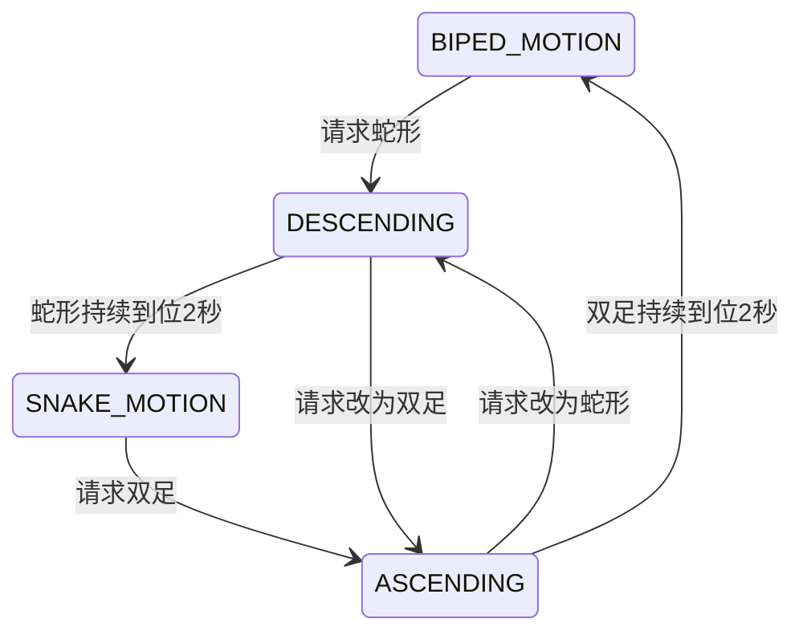

# 显式构型与任务状态机

统一入口：`bash train.sh`训练，`bash run.sh`回放。两者指向同一个宽范围双足全能教师任务；原任务保留作对照。专用启动脚本已移除。默认新run名为`task_fsm_v1`。

## 状态与事件

每个机器人独立保存：

| 字段 | 含义 |
| --- | --- |
| current_morphology | 已确认的双足／蛇形；正在变形时标为TRANSITION |
| source_morphology | 变形前最后确认的构型 |
| target_morphology | 初始化或明确构型指令指定的目标 |
| current_task | BIPED_MOTION、SNAKE_MOTION、ASCENDING、DESCENDING |
| requested_velocity | 当前任务要执行的vx/vy/wz请求 |

任务只由以下事件改变：规范初态初始化、明确的新构型请求、变形持续到位确认、回合重置。速度请求的改变不会切换构型。单帧接触丢失、短暂腾空、高度或姿态波动不会改变任务，也不会将位置动作悄悄改成积分速度动作。



变形途中反向请求仍进入相应变形任务，不能因为目标恰好等于旧构型就直接宣布完成。局部键盘请求只修改当前选中机器人，其他机器人状态保持。真实跌倒仍由安全终止回收；状态机中的“已确认构型”不是每帧重新猜测的瞬时姿态标签。

Actor的59维输入结构保持不变，已有四维阶段one-hot现在由显式状态机发布；目标构型与实际任务分开保存。回放窗口状态栏增加构型、来源、目标、任务以及请求／有效速度。新检查点记录`task_fsm_version=1`；旧检查点回放会提示尚未经过新逻辑训练，代码更新不会自动改变模型权重。

## 第450轮定位到的问题

旧训练逻辑把一帧足部接触丢失当作重新变形，随即关闭速度奖励、将有效速度压向零、把双足位置动作改成积分动作；重新运动还要满足关节接近标准站姿±.15rad并保持2秒。CPU复现中，接触恢复后保持合法`.2rad`步态偏移，5秒后有效vx仍只有约`1.22e-10m/s`。

冻结450轮策略、100个训练配置环境、8秒随机策略回放：旧逻辑发生25次无指令双足运动→起立切换，双足运动环境34.24%的帧落入起立。仅锁定运动任务的反事实回放中，这些切换为0，双足运动帧占比100%；保留真实跌倒终止。这证明了控制缺陷存在，不代表已经通过训练恢复全部技能。

同一回放中，双足／蛇运动环境累计得到约636／637的额外构型奖励，而速度奖励约424／269。这份构型正奖励不属于独立运动归档的平衡；固定−10变形失败费也被误用于双足跌倒。因此本次将构型奖励、构型进步奖励和固定失败费限定于变形任务，运动仍保留归档upright、运动跟踪、足底与能耗等项及真实判摔终止。没有再改变网络、动作范围、PPO或增加奖励权重。

原始旧逻辑／反事实记录：`outputs/diagnostics/model450_motion_gate_probe.json`。新实现GPU回放结果：`outputs/diagnostics/task_fsm_gpu_check.json`。

## 日志与启动

默认关闭每100轮及500轮的自动验收，不再创建额外验收环境或打印阶段汇总。保留精简PPO日志及每50轮检查点。

```bash
bash train.sh
bash run.sh
# 指定回放检查点
bash run.sh --checkpoint-file <检查点路径>
```

当前已启动进程不会热加载这些修改；需要由用户重新启动训练。旧450轮模型仍是旧权重，修复状态机不会使它立即学会运动。本轮没有启动训练或停止用户进程，仅做回放、单元测试及状态一致性检查。

500轮仍停滞的实测与使用同一`train.sh`／`run.sh`进行单技能受控对照，见[500轮复测](fsm-training-stall-control.md)。全局采样占比改从完整rollout记录到TensorBoard。
