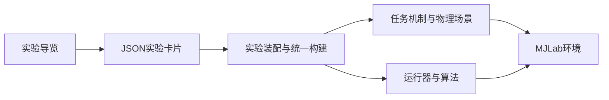

# 任务、实验与参数卡片分级

更新：2026-10-21。保留35个实验及其模型接口，以单向依赖区分复用机制、实验装配和可编辑参数。

## 从哪里进入

日常调参从[实验导览](../experiments.md)点击对应卡片。网络层宽、PPO参数、环境控制量和奖励权重统一写在 `src/zbot_rl_mjlab/experiments/cards/` 的JSON文件里。

| 层次 | 负责什么 | 不放什么 |
|---|---|---|
| 卡片 | 参数、显式继承、train/play差异 | Python回调、任务ID替换、Runner替换 |
| 实验 | 选择任务能力、绑定奖励/观测/动作，组合对照与扰动 | 奖励数值计算、每步物理状态更新 |
| 任务 | 通用场景、配置类型、命令/动作、奖励/终止/重置计算 | 具体训练的PPO配方与实验装配 |
| 运行器/算法 | 采样、优化、蒸馏、自适应调权及检查点 | 独立实验的配置工厂 |

任务层没有到实验层的反向导入。运行回调和dataclass保持原模块路径；搬动的是配置组装函数，保护归档中的函数/类型身份。

## 实验配方的归属

| 任务族 | 环境与奖励装配、PPO配方 | 可复用行为 |
|---|---|---|
| 双足行走 | `experiments/walking.py`；平足、扰动、部署和调参增量仍在对应具名实验模块 | `tasks/walking/` |
| 单向变形 | `experiments/transformation.py` | `tasks/transformation/` |
| 双向变形 | `experiments/bidirectional.py` | `tasks/transformation/commanded.py` |
| 世界X蛇形推进 | `experiments/snake.py` | `tasks/snake/` |
| Site/Base/前进对照/归档蛇形 | `experiments/site_snake.py` | `tasks/snake/site_omni.py`、`site_forward.py`、`base_omni.py`与归档运行器 |
| 综合部署学生 | `experiments/universal.py` | `tasks/universal/`与`distillation.py` |
| 特权教师及分组/分任务/指导变体 | `experiments/omni_teacher.py` | `tasks/universal/`与各教师运行器 |
| 公共默认 | `experiments/common.py`；可编辑数值由 `_defaults.json` 及实验卡片提供 | 共享addons与物理行为 |

原 `tasks/transformation/presets.py` 只有实验装配，已并入变形实验模块并删除。原任务/运行器模块的环境和PPO工厂已迁出，项目内部及测试导入统一到实验层，没有保留两套配置或转发工厂。

共享的 `transformation_scene_cfg` 和机器人spec仍在任务/模型层，因为它们服务于多种能力，而不是某一项训练配方。

## 一次构建，一次参数覆盖

1. `create_env()` 选择任务场景与配置类型。
2. 沿基类到子类执行自身声明的 `reward_edit()` / `edit()`，每个钩子一次，钩子中不调用 `super().edit()`。
3. 读取卡片继承链，配置同类型addons；动态命令行变体的显式参数优先，然后按固定顺序各应用一次。
4. 应用公共环境/奖励参数，再应用train/play差异。扩展拥有的扰动/噪声/延迟参数只在addons中配置，不在env中重复覆盖。
5. `build_ppo()` 调用 `_build_ppo()` 完成普通Python继承的配方组装，再统一应用卡片的agent参数。
6. `register()` 把最终train/play环境、PPO配置和Runner送入MJLab。之后命令行参数可以覆盖注册默认值。

所有注册实验共用 `build_env()`、`build_ppo()` 和 `register()`。子类只覆盖 `_build_ppo()`，避免某个子实验忘记应用卡片，也避免父类过早应用造成覆盖失效。

卡片每次构建都重新读文件；没有代码生成步骤或需要同步的第二份参数文件。注册配置已创建后，重新启动训练/回放来获取修改，运行中的策略不热更网络。动态CLI变体继承原实验卡片，但保留自身任务标识和新增扩展。

## 继承与模型边界

- 实验类保留已有的真实行为继承；卡片以 `inherits` 显式声明参数继承，子卡片覆盖值优先。
- `train` / `play` 表达实际模式差异，例如回放不自动重置、训练才启用外扰；这些差异不再藏在另一份参数表。
- 奖励、观测、动作及重置函数继续由任务层实现。卡片可选参数，不能借参数文件替换执行代码。
- Site iter599归档仍为56维Beta，现代自适应/base/forward仍为61维Gaussian；对应卡片和Runner独立。改变网络结构或控制接口后需要匹配检查点，归档文件不随卡片编辑改变。
- `train.sh`、`run.sh` 完全保持本轮开始时的字节内容和原注释选择方式。

## 验证约束

`tests/test_experiment_configuration_contracts.py` 对全部35实验的train/play环境、PPO、Runner和回调路径做完整配置对照；初始卡片和分层迁移必须保持这些契约。

`tests/test_experiment_cards.py` 验证继承、字段校验、文件更新生效、真实实验网络/奖励同步及训练/回放参数一致。`tests/test_experiment_architecture.py` 约束任务层依赖方向、配置工厂归属和统一构建入口。

主动调参后，配置契约对照可能报差异；先核实变更就是预期参数，再有意识地更新基线，不能为了让测试通过自动覆盖基线。网络/动作参数修改后的收敛与实机效果不由配置契约证明。
